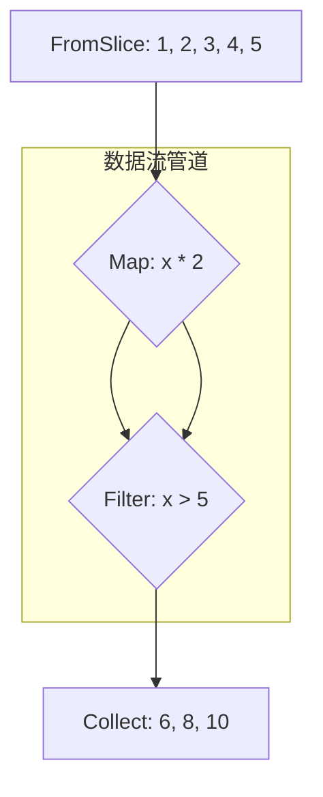

+++
title = "Go 泛型实战"
description = "go"
keywords = ["Go"]
date = 2025-09-14T17:16:00+08:00
authors = ["muzhy"]
tags = ["Go"]
categories = ["Go"]
cover = "/images/go_generic_in_actin.png"
draft = true
+++

你是否也曾被 Go 泛型复杂的类型约束搞得头大？或者在阅读开源项目时，看到 `[T any, R any]` 这样的代码就想直接跳过？

很多人都觉得 Go 泛型学起来抽象，难以在实际工作中应用。但如果我告诉你，通过一个简单的数据流处理库，不仅能让你轻松上手泛型，还能写出更简洁、更强大的代码呢？

这篇文章将带你通过一个实战项目，彻底告别对泛型的恐惧，让你真正掌握它。我们开始吧！
# 一. 引言

### 1.1 没有泛型的世界
在没有泛型的时代，我们通常会面临两种选择：要么为每一种数据类型编写一个独立的函数，要么使用`interface{}`来实现通用性。
#### 1.1.1 为每种类型编写独立函数
例如，我们需要过滤`[]int`和`[]string`，代码可能会像这样：
```go
func FilterInts(data []int, f func(int) bool) []int {
    // ... 实现细节
}
func FilterStrings(data []string, f func(string) bool) []string {
    // ... 实现细节
}
// 这种模式导致了大量的重复代码，增加了开发者的工作量，也使得代码难以维护。
```
#### 1.1.2 使用 `interface{}` 实现通用性

使用`interface{}`来编写一个通用的`Filter`函数是一种常用方案。但这样做会带来新的问题，比如类型不安全和额外的类型断言开销：

```go
func Filter(data []interface{}, f func(interface{}) bool) []interface{} {
    // ... 实现细节
}

func main() {
// 使用时，我们必须手动进行类型断言，这不仅繁琐，而且容易出错
	var ints []interface{} = ...
    Filter(ints, func(x interface{}) bool {
    val, ok := x.(int) // 必须手动断言
	    if !ok {
	        return false
	    }
	    return val > 10
	})
}
```

### 1.2 千呼万唤始出来
Go 语言的泛型特性在1.18 版本中正式引入。 Go 泛型的诞生，是 Go 语言社区期待已久的大事件。

自 Go 语言发布以来，开发者们一直面临着一个痛点：如何在保证静态类型安全的同时，编写出可以处理多种数据类型的通用代码。在 Go 1.18 版本之前，我们常常需要借助`interface{}`和反射来解决这个问题，但这往往会牺牲性能，并且导致代码的可读性变差，类型转换的麻烦也让人头疼。

### 1.3 犹抱琵琶半遮面
Go 泛型的到来，为我们带来了代码复用和类型安全的新可能。

然而，它并不是“大而全”的。Go 泛型从设计之初就秉持着 Go 语言一贯的“简单至上”哲学。它不像 C++、Java 或 Rust 那样提供了包罗万象的泛型功能（例如，Go 泛型不支持给方法添加类型参数），而是有选择性地舍弃了一些复杂特性，旨在在**代码复用**、**类型安全**和**编译速度**之间取得最佳平衡。这种设计让 Go 的泛型用起来更加轻量和直观

## 二. Go 泛型基础

在正式进入实战之前，我们先快速了解一下 Go 泛型的核心概念和基本语法。这部分内容将为掌握后续的实战案例打下坚实的基础。

### 2.1 泛型函数

在 Go 中，我们可以通过在函数名和参数列表之间添加**类型参数列表**来定义一个泛型函数。这些**类型参数**可以像普通类型一样在函数签名中使用，实现对多种类型的支持。

以数据流处理中常见的`Filter`函数为例，使用泛型后，我们可以只用一个函数，就能对任何类型的切片进行过滤操作：

```go
// 这是一个泛型Filter函数，E是类型参数
func Filter[E any](data []E, filter func(E) bool) []E {
    var result []E
    for _, v := range data {
        if filter(v) {
            result = append(result, v)
        }
    }
    return result
}
```

### 2.2 泛型类型

除了泛型函数，我们还可以定义泛型类型，来创建能够持有不同类型数据的通用数据结构。这在构建一些通用的数据结构如键值对时非常有用。例如，在`lapluma`库中，我们定义了一个泛型`Pair`类型：

```go
// Pair是一个泛型类型
type Pair[K, V any] struct {
    Key   K
    Value V
}
```

### 2.3 类型约束
泛型中的类型约束是保证类型安全的关键。它限定了类型参数所能接受的类型范围。Go 泛型提供了两种主要的类型约束方式：
1. **`any`**：`any`是`interface{}`的别名，代表任何类型。它提供了最大的灵活性，但牺牲了对操作的约束，例如，你无法在`any`类型上直接进行数学运算。我们在`Filter`和`Pair`的示例中都使用了`any`。
    
2. **自定义接口**：我们可以通过自定义接口来定义更具体的类型约束。例如，如果你想编写一个通用的`Add`函数，你需要确保类型参数支持`+`操作，这可以通过接口来实现。Go 标准库提供了`constraints.Ordered`这样的接口，用于约束类型参数为可排序的类型。

## 三. 泛型实战：数据流处理库 `LaPluma`拆解

### 3.1 痛点再分析

在第一章中，我们回顾了在没有泛型时，为了实现通用的`Filter`等数据处理功能，我们不得不依赖`interface{}`和类型断言。虽然`interface{}`可以实现代码的通用性，但它带来了新的痛点：

- **类型不安全**：编译器无法在编译时进行类型检查，这使得类型错误只能在运行时发现，增加了潜在的`panic`风险。    
- **性能开销**：`interface{}`的动态派发和额外的类型断言会带来一定的性能损耗，对于高性能计算场景并不理想。    
- **代码复杂性**：代码中充斥着大量的类型转换和错误检查，大大降低了可读性和可维护性。
    

### 3.2 `LaPluma`拆解

为了解决上述问题，我开发了一个名为 LaPluma 的数据流处理库，其核心设计理念是通过 Go 泛型提供一套简洁、可组合且类型安全的工具集。它旨在让开发者能够以函数式编程的风格，清晰地构建出复杂的数据处理流水线。

关于LaPluma的更多介绍，可阅读 [LaPluma](https://github.com/muzhy/lapluma)

`LaPluma`提供了两个核心组件：`Iterator`用于串行数据处理，是本章实战案例的重点，而`Pipe`则用于并发数据处理。
### 3.2.1 核心实现拆解：以 `Iterator` 为例
`Iterator` 是 `LaPluma` 的核心组件，它利用泛型实现了类型安全和简洁的串行数据流处理。让我们以`Filter`和`Map`函数为例，看看泛型是如何解决问题的。
#### 3.2.1.1 `Filter`
首先，`LaPluma`提供了`FromSlice`函数，可以从一个任意类型的切片快速创建一个迭代器。然后，我们可以通过`Filter`函数对迭代器中的元素进行过滤。`Filter`函数的代码片段如下：

```go
// 这是一个泛型Filter函数，E是类型参数
func Filter[E any](it Iterator[E], filter func(E) bool) Iterator[E] {
    return &FilterIterator[E]{
        input:  it,
        filter: filter,
    }
}
```
通过泛型，`Filter`函数的类型参数`E`被约束为`any`，这意味着它可以处理任何类型的切片。在函数体内，`E`代表了切片元素的具体类型，保证了`filter`函数和返回值的类型安全。

#### 3.2.1.2 `Map`与链式操作

同样，`Map`函数也通过泛型实现了优雅的数据转换。它的核心代码片段如下：

```go
type MapIterator[E, R any] struct {
    handler func(E) R
    input   Iterator[E]
    closed  bool
}

func Map[E, R any](it Iterator[E], handler func(E) R) Iterator[R] {
    return &MapIterator[E, R]{
        input:   it,
        handler: handler,
        closed:  false,
    }
}
```

`Map`函数返回一个新的迭代器`MapIterator`，这个新迭代器在每次调用`Next()`时，会先从上游迭代器获取元素，然后将该元素传入`handler`进行转换，最后返回转换后的结果。

有了这些泛型函数，我们就可以像函数式编程一样，以嵌套的方式来组合操作，构建一个简洁、可读的数据处理流水线。

```go
// 创建迭代器
data := []int{1, 2, 3, 4, 5}
it := iterator.FromSlice(data)

// 链式操作 
result := iterator.Collect( 
	iterator.Filter( 
		iterator.Map(it, func(x int) int { return x * 2 }), 
		func(x int) bool { return x > 5 } 
	) 
) // [6, 8, 10]
```

你可能会好奇，为什么`LaPluma`中要采用这种嵌套的函数调用方式，而不是像其他语言（例如Java的Stream API、Rust的迭代器）那样，使用`it.Map(...).Filter(...)`这样的链式方法调用呢？

这正是Go泛型在设计上的一个重要取舍：**Go泛型目前不支持为方法添加类型参数**。这意味着，我们无法在`Iterator[E]`这个类型上定义一个`Map`方法，因为`Map`方法需要一个不同于`E`的类型参数`R`（即转换后的类型）。

### 3.2.2 错误处理实践

`LaPluma`在设计上将错误视为数据流的一部分来处理，而不是通过函数签名返回`error`，这使得代码更加简洁。

#### 3.2.2.1 使用 `TryMap` 处理可失败的转换

当数据转换过程本身可能失败时，`LaPluma`提供了`TryMap`函数。它的`handler`签名为`func(T) (R, error)`。当`handler`返回一个非`nil`的`error`时，`TryMap`会自动跳过（丢弃）这个元素，并继续处理下一个。

```go
import (
    "strconv"
    "errors"
)
// 示例：将字符串转换为整数，失败则跳过
stringPipe := FromSlice([]string{"1", "two", "3", "four"})
// 使用 TryMap，handler 返回 (int, error) 
intPipe := TryMap(stringPipe, func(s string) (int, error) { 
	i, err := strconv.Atoi(s) 
	if err != nil { 
		// 返回错误，这个元素将被丢弃 
		return 0, errors.New("not a number") 
	} 
	return i, nil 
}) // 最终 Collect 只会处理成功转换的 {1, 3} 
result := Collect(intPipe) // result 的结果是 [1, 3]
```



这种模式使得流水线在遭遇“数据级”错误时可以保持运行，而不会被中断。

## 3.3 泛型前后对比

现在，让我们直观地对比一下泛型和`interface{}`在实现通用`Filter`功能上的差异，以便更好地理解泛型带来的价值。

**泛型前 (`interface{}`)**
```go
func Filter(data []interface{}, f func(interface{}) bool) []interface{} {
	var result []interface{}
	for _, v := range data {
		if f(v) {
			result = append(result, v)
		}
	}
	return result
}
func main() {
	// 使用时需要手动类型断言和错误处理，非常繁琐
	ints := []int{1, 2, 3, 4, 5}
	var interfaceSlice []interface{}
	for _, i := range ints {
	    interfaceSlice = append(interfaceSlice, i)
	}
	filtered := Filter(interfaceSlice, func(v interface{}) bool {
	    if i, ok := v.(int); ok {
			return i > 2
	    }
	    return false
	})
}
```

**泛型后**
```go
func Filter[E any](it Iterator[E], filter func(E) bool) Iterator[E] {
	return &FilterIterator[E]{
		input:  it,
		filter: filter,
	}
}
func main(){
	// 使用时类型安全，无需手动断言
	data := []int{1, 2, 3, 4, 5}
	it := FromSlice(data)
	result := Collect(
		Filter(it, func(x int) bool { return x > 2 })
	)
}
```

通过对比，我们可以清晰地看到泛型带来的优势：
- **类型安全**：泛型在编译时进行类型检查，避免了运行时`panic`。    
- **代码简洁**：泛型代码更少，更易于理解。`interface{}`方案需要大量的类型转换和错误处理代码。    
- **性能更优**：泛型代码经过 Go 编译器的优化，通常比`interface{}`和反射的性能更好。

## 四. 总结

Go泛型的到来，为Go语言开发者带来了编写通用、高效和类型安全代码的新范式。通过我们手撸`LaPluma`数据流处理库的实战案例，我们可以清晰地看到泛型所带来的核心价值：

- **告别`interface{}`地狱，实现真正的类型安全**：在泛型之前，我们不得不依赖`interface{}`和类型断言来实现通用功能，这带来了运行时类型断言失败的`panic`风险。而Go泛型在编译时就对类型进行了严格约束和检查，将类型错误前置，从根本上消除了这类风险。
    
- **代码复用性和可读性的大幅提升**：泛型让开发者能够编写一套通用的代码逻辑，适用于多种数据类型，从而避免了为每种类型编写独立函数所导致的冗余代码。同时，泛型代码的类型信息在编译时就已确定，无需像`interface{}`那样进行繁琐的类型转换和错误处理，使得代码更加简洁、可读。
    
- **性能更优**：相比于`interface{}`的动态派发和反射，Go泛型在编译时通过类型参数生成了针对特定类型的代码，其性能表现通常更优。
    

Go泛型并非“大而全”，它秉持了Go语言一贯的“简单至上”哲学，在代码复用、类型安全和编译速度之间取得了最佳平衡。它特别适用于构建通用数据结构（如列表、队列、栈）、算法库以及类似`LaPluma`这样的数据处理工具，为Go语言生态带来了新的活力。

---
你觉得Go泛型在你的项目中还有哪些妙用？欢迎在评论区分享你的看法！

这次主要通过一个实战案例，带大家快速掌握了Go泛型的用法。但是，你是否也对泛型背后的设计思想、与其他语言（如C++、Rust）的异同、以及泛型对性能的真实影响感到好奇？

如果你对这些话题感兴趣，不妨点个“**关注**”，我们将在后续文章中深入探讨！也请不要忘记**点赞**、**在看**和**分享**，你的支持是我持续创作的最大动力！
