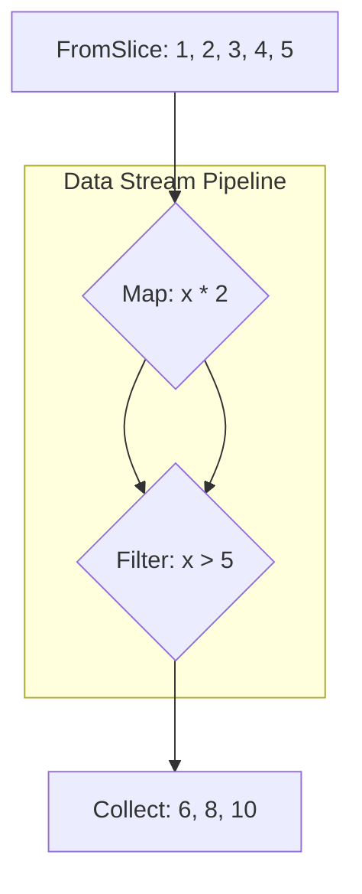

+++
title = "Go Generics in Action: From Fear to Mastery with a Data Streaming Library"
description = "A practical guide to mastering Go generics. Learn how to overcome the complexities of type constraints and build a simple, type-safe data streaming library, inspired by La Pluma, to write cleaner and more powerful Go code."
keywords = ["Go", "Golang", "Go Generics", "Generics Tutorial", "Data Streaming", "Functional Programming", "Type Safety", "Go Library", "La Pluma", "Map Filter Reduce", "Go Best Practices"]
date = 2025-09-15T16:29:02+08:00
authors = ["muzhy"]
tags = ["Go", "Generics"]
categories = ["Go"]
cover = "/images/go_generic_in_actin.png"
draft = false
+++

Have you ever found yourself scratching your head over Go's complex generic type constraints? Or felt the urge to skip over code like `[T any, R any]` when reading open-source projects?

Many developers find Go generics abstract and difficult to apply in their daily work. But what if I told you that by building a simple data streaming library, you could not only master generics with ease but also write more concise and powerful code?

This article will guide you through a hands-on project to completely eliminate your fear of generics and truly master them. Let's get started!

# 1. Introduction

### 1.1 The World Without Generics

In the era before generics, we typically faced two choices: either write a separate function for each data type or use `interface{}` to achieve generality.

#### 1.1.1 Writing a Function for Each Type

For example, if we needed to filter `[]int` and `[]string`, the code might look like this:

```go
func FilterInts(data []int, f func(int) bool) []int {
    // ... implementation details
}
func FilterStrings(data []string, f func(string) bool) []string {
    // ... implementation details
}
// This pattern leads to a lot of duplicate code, increasing developer workload and making the code difficult to maintain.
```

#### 1.1.2 Using `interface{}` for Generality

Using `interface{}` to write a generic `Filter` function was a common solution. However, this introduced new problems, such as a lack of type safety and the overhead of type assertions:

```go
func Filter(data []interface{}, f func(interface{}) bool) []interface{} {
    // ... implementation details
}

func main() {
    // When using it, we must manually perform type assertions, which is not only tedious but also error-prone.
    var ints []interface{} = // ...
    Filter(ints, func(x interface{}) bool {
        val, ok := x.(int) // Must manually assert the type
        if !ok {
            return false
        }
        return val > 10
    })
}
```

### 1.2 The Long-Awaited Arrival

Go's generics feature was officially introduced in version 1.18. The birth of Go generics was a major event long-awaited by the Go community.

Since Go's release, developers have grappled with a persistent pain point: how to write generic code that can handle multiple data types while maintaining static type safety. Before Go 1.18, we often had to rely on `interface{}` and reflection to solve this problem, but this usually came at the cost of performance and led to less readable code, not to mention the headache of type conversions.

### 1.3 A Glimpse Behind the Veil

The arrival of Go generics brought new possibilities for code reuse and type safety.

However, it is not an "all-encompassing" feature. From its inception, Go generics have adhered to Go's consistent philosophy of "simplicity first." Unlike C++, Java, or Rust, which offer a vast array of generic features (for example, Go generics do not support adding type parameters to methods), Go has selectively omitted some complex features. The goal is to strike the best balance between **code reuse**, **type safety**, and **compilation speed**. This design makes Go generics feel more lightweight and intuitive.

## 2. Go Generics Fundamentals

Before we dive into the practical example, let's quickly go over the core concepts and basic syntax of Go generics. This will lay a solid foundation for mastering the case study that follows.

### 2.1 Generic Functions

In Go, we can define a generic function by adding a **type parameter list** between the function name and the parameter list. These **type parameters** can be used like regular types in the function signature, enabling support for multiple types.

Taking the common `Filter` function from data stream processing as an example, with generics, we can use a single function to filter a slice of any type:

```go
// This is a generic Filter function, where E is a type parameter.
func Filter[E any](data []E, filter func(E) bool) []E {
    var result []E
    for _, v := range data {
        if filter(v) {
            result = append(result, v)
        }
    }
    return result
}
```

### 2.2 Generic Types

In addition to generic functions, we can also define generic types to create general-purpose data structures that can hold different types of data. This is very useful for building common structures like key-value pairs. For instance, in the `lapluma` library, we define a generic `Pair` type:

```go
// Pair is a generic type.
type Pair[K, V any] struct {
    Key   K
    Value V
}
```

### 2.3 Type Constraints

Type constraints in generics are key to ensuring type safety. They limit the range of types that a type parameter can accept. Go generics provide two main ways to define constraints:

1.  **`any`**: `any` is an alias for `interface{}`, representing any type. It offers maximum flexibility but sacrifices constraints on operations. For example, you cannot perform mathematical operations directly on a value of type `any`. We used `any` in both our `Filter` and `Pair` examples.

2.  **Custom Interfaces**: We can define more specific type constraints using custom interfaces. For example, if you want to write a generic `Add` function, you need to ensure the type parameter supports the `+` operation, which can be achieved with an interface. The Go standard library provides interfaces like `constraints.Ordered` to constrain type parameters to ordered types.

## 3. Generics in Action: Dissecting the `LaPluma` Data Streaming Library

### 3.1 Re-analyzing the Pain Points

In the first chapter, we reviewed how, without generics, we had to rely on `interface{}` and type assertions to implement common data processing functions like `Filter`. While `interface{}` could achieve code generality, it brought new pain points:

-   **Not Type-Safe**: The compiler cannot perform type checks at compile time, meaning type errors can only be discovered at runtime, increasing the risk of `panic`.
-   **Performance Overhead**: The dynamic dispatch of `interface{}` and extra type assertions introduce a certain performance penalty, which is not ideal for high-performance computing scenarios.
-   **Code Complexity**: The code becomes cluttered with numerous type conversions and error checks, significantly reducing readability and maintainability.

### 3.2 Dissecting `LaPluma`

To solve the problems above, I developed a data streaming library called `LaPluma`. Its core design philosophy is to provide a concise, composable, and type-safe toolset using Go generics. It aims to enable developers to build complex data processing pipelines clearly, in a functional programming style.

For more about LaPluma, you can read its documentation: LaPluma

`LaPluma` provides two core components: `Iterator` for sequential data processing, which is the focus of our practical example in this chapter, and `Pipe` for concurrent data processing.

#### 3.2.1 Core Implementation: An `Iterator` Example

`Iterator` is a core component of `LaPluma` that leverages generics to achieve type-safe and concise sequential data stream processing. Let's look at the `Filter` and `Map` functions to see how generics solve the problem.

##### 3.2.1.1 `Filter`

First, `LaPluma` provides a `FromSlice` function that can quickly create an iterator from a slice of any type. Then, we can use the `Filter` function to filter elements in the iterator. A snippet of the `Filter` function's code is as follows:

```go
// This is a generic Filter function, where E is a type parameter.
func Filter[E any](it Iterator[E], filter func(E) bool) Iterator[E] {
    return &FilterIterator[E]{
        input:  it,
        filter: filter,
    }
}
```

With generics, the type parameter `E` of the `Filter` function is constrained to `any`, meaning it can handle a slice of any type. Inside the function, `E` represents the concrete type of the slice elements, ensuring the type safety of the `filter` function and the return value.

##### 3.2.1.2 `Map` and Chained Operations

Similarly, the `Map` function also achieves elegant data transformation through generics. Its core code snippet is as follows:

```go
type MapIterator[E, R any] struct {
    handler func(E) R
    input   Iterator[E]
    closed  bool
}

func Map[E, R any](it Iterator[E], handler func(E) R) Iterator[R] {
    return &MapIterator[E, R]{
        input:   it,
        handler: handler,
        closed:  false,
    }
}
```

The `Map` function returns a new iterator, `MapIterator`. Each time `Next()` is called on this new iterator, it first gets an element from the upstream iterator, passes that element to the `handler` for transformation, and finally returns the transformed result.

With these generic functions, we can compose operations in a nested fashion, just like in functional programming, to build a concise and readable data processing pipeline.

```go
// Create an iterator
data := []int{1, 2, 3, 4, 5}
it := iterator.FromSlice(data)

// Chained operations
result := iterator.Collect(
    iterator.Filter(
        iterator.Map(it, func(x int) int { return x * 2 }),
        func(x int) bool { return x > 5 },
    ),
) // [6, 8, 10]
```

You might be wondering why `LaPluma` uses this nested function call style instead of the chained method calls seen in other languages (like Java's Stream API or Rust's iterators), such as `it.Map(...).Filter(...)`.

This is a key trade-off in Go's generic design: **Go generics currently do not support adding type parameters to methods**. This means we cannot define a `Map` method on the `Iterator[E]` type, because the `Map` method would need a type parameter `R` (the transformed type) that is different from `E`.

#### 3.2.2 Error Handling in Practice

`LaPluma` is designed to treat errors as part of the data stream rather than returning `error` from function signatures, which makes the code more concise.

##### 3.2.2.1 Using `TryMap` for Fallible Transformations

When the data transformation process itself can fail, `LaPluma` provides the `TryMap` function. Its `handler` has the signature `func(T) (R, error)`. When the `handler` returns a non-`nil` `error`, `TryMap` automatically skips (discards) that element and continues processing the next one.

```go
import (
    "strconv"
    "errors"
)

// Example: Convert strings to integers, skip on failure
stringPipe := FromSlice([]string{"1", "two", "3", "four"})

// Use TryMap; the handler returns (int, error)
intPipe := TryMap(stringPipe, func(s string) (int, error) {
    i, err := strconv.Atoi(s)
    if err != nil {
        // Return an error, and this element will be discarded
        return 0, errors.New("not a number")
    }
    return i, nil
})

// The final Collect will only process the successfully converted {1, 3}
result := Collect(intPipe) // result is [1, 3]
```



This pattern allows the pipeline to keep running without interruption when encountering "data-level" errors.

### 3.3 Before and After Generics: A Comparison

Now, let's visually compare the difference between using generics and `interface{}` to implement a generic `Filter` function to better understand the value generics bring.

**Before Generics (`interface{}`)**

```go
func Filter(data []interface{}, f func(interface{}) bool) []interface{} {
    var result []interface{}
    for _, v := range data {
        if f(v) {
            result = append(result, v)
        }
    }
    return result
}

func main() {
    // Usage requires manual type assertions and error handling, which is very tedious.
    ints := []int{1, 2, 3, 4, 5}
    var interfaceSlice []interface{}
    for _, i := range ints {
        interfaceSlice = append(interfaceSlice, i)
    }
    filtered := Filter(interfaceSlice, func(v interface{}) bool {
        if i, ok := v.(int); ok {
            return i > 2
        }
        return false
    })
}
```

**After Generics**

```go
func Filter[E any](it Iterator[E], filter func(E) bool) Iterator[E] {
    return &FilterIterator[E]{
        input:  it,
        filter: filter,
    }
}

func main(){
    // Type-safe, no manual assertions needed.
    data := []int{1, 2, 3, 4, 5}
    it := FromSlice(data)
    result := Collect(
        Filter(it, func(x int) bool { return x > 2 })
    )
}
```

The comparison clearly shows the advantages of generics:

-   **Type Safety**: Generics perform type checking at compile time, preventing runtime `panic`s.
-   **Code Conciseness**: Generic code is shorter and easier to understand. The `interface{}` solution requires a lot of type conversion and error-handling code.
-   **Better Performance**: Generic code, optimized by the Go compiler, generally performs better than code using `interface{}` and reflection.

## 4. Conclusion

The arrival of Go generics has provided Go developers with a new paradigm for writing generic, efficient, and type-safe code. Through our hands-on example of building the `LaPluma` data streaming library, we can clearly see the core value that generics bring:

-   **Escape from `interface{}` Hell, Achieve True Type Safety**: Before generics, we had to rely on `interface{}` and type assertions for generic functionality, which introduced the risk of runtime `panic`s from failed type assertions. Go generics, however, enforce strict type constraints and checks at compile time, catching type errors early and fundamentally eliminating this class of risks.
-   **Significant Improvement in Code Reusability and Readability**: Generics allow developers to write a single set of generic logic that applies to multiple data types, thus avoiding the redundant code that comes from writing separate functions for each type. At the same time, the type information in generic code is determined at compile time, eliminating the need for tedious type conversions and error handling associated with `interface{}`, making the code cleaner and more readable.
-   **Better Performance**: Compared to the dynamic dispatch and reflection of `interface{}`, Go generics generate code specific to the given types at compile time, which generally results in better performance.

Go generics are not an "all-encompassing" feature; they adhere to Go's long-standing philosophy of "simplicity first," striking an optimal balance between code reuse, type safety, and compilation speed. They are particularly well-suited for building generic data structures (like lists, queues, and stacks), algorithm libraries, and data processing tools like `LaPluma`, bringing new vitality to the Go ecosystem.

---

How do you think Go generics could be useful in your projects? Feel free to share your thoughts in the comments section!

This article focused on a practical example to help you quickly grasp the usage of Go generics. But are you also curious about the design philosophy behind them, how they compare to generics in other languages (like C++, Rust), and their real-world performance impact?

If you're interested in these topics, be sure to "**Follow**" for our upcoming deep dives! And don't forget to **Like**, **Share**, and **Star**—your support is my biggest motivation for creating more content!